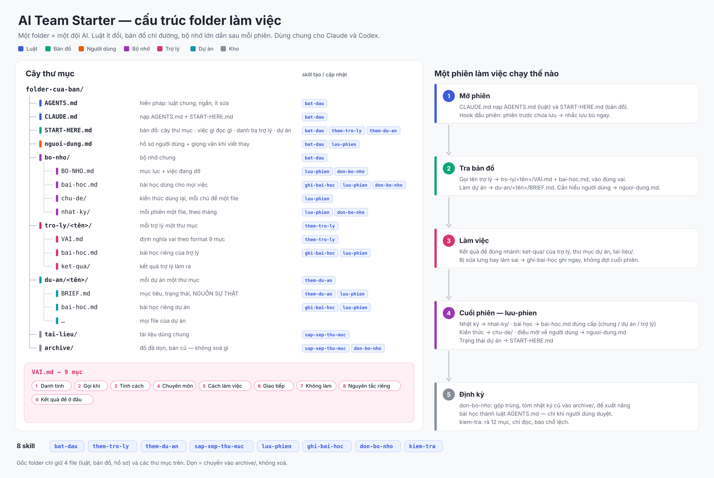

# AI Team Starter

Dựng **đội AI riêng** trong folder làm việc của bạn — chạy được trên **Claude** (Claude Code, Claude desktop) và **Codex**.

Cài xong, AI tự mời bạn trả lời vài câu (tối đa 5), rồi viết sẵn file luật **`AGENTS.md`** cho folder. Từ đó, mỗi phiên AI đều biết bạn là ai, làm việc theo cách nào, việc gì phải hỏi trước. Các thứ khác — trợ lý có tên riêng, dự án, sắp xếp thư mục — bạn gọi thêm khi cần.

**Hai bản / Two editions** — cài **một** trong hai / install **one**:

| Plugin | Ngôn ngữ / Language | Skill |
|---|---|---|
| `ai-team` | Tiếng Việt | `bat-dau`, `them-tro-ly`, `them-du-an`, `sap-xep-thu-muc`, `luu-phien`, `ghi-bai-hoc`, `don-bo-nho`, `kiem-tra` |
| `ai-team-en` | English | `setup`, `add-assistant`, `add-project`, `organize-folder`, `save-session`, `add-lesson`, `tidy-memory`, `health-check` |

Cả hai bản trò chuyện được bằng mọi ngôn ngữ; bản chỉ quyết định tên skill, tên thư mục và ngôn ngữ mặc định của file luật. Cài cả hai sẽ bị mời setup hai lần.

*English guide at the end.*

---

## Cài đặt

**Claude Code**

```
/plugin marketplace add LeHungViet/ai-team-starter
/plugin install ai-team@ai-team-starter
```

(Bản tiếng Anh: `/plugin install ai-team-en@ai-team-starter`.)

Mở phiên mới trong folder bạn muốn dùng.

**Claude desktop:** thêm marketplace `LeHungViet/ai-team-starter` trong phần quản lý plugin, cài plugin **ai-team**, rồi chọn folder làm việc.

**Codex**

```
codex plugin marketplace add LeHungViet/ai-team-starter
```

Rồi cài **AI Team Starter** trong ứng dụng Codex — Codex chạy bước setup ngay sau khi cài. Cài bằng dòng lệnh cũng được: `codex plugin add ai-team@ai-team-starter`. Trên Codex, skill hiện với tên `ai-team:bat-dau`, `ai-team:them-tro-ly`…; hook mời setup chỉ chạy sau khi bạn duyệt (trust) hook của plugin.

## Cài xong thì sao

1. Mở folder chưa có `AGENTS.md`/`CLAUDE.md` → AI mời: *"Folder này chưa có file luật, dựng nhanh trong 2 phút nhé?"* Mỗi folder chỉ được mời một lần.
2. Đồng ý → AI hỏi tối đa 5 câu: gọi bạn là gì, bạn làm gì, muốn AI làm việc kiểu nào, ngôn ngữ, có đặt tên cho trợ lý chính không.
3. AI tạo:
   - **`AGENTS.md`** — hiến pháp: luật tổng quát duy nhất (Codex và Claude đều đọc). AI không tự sửa file này.
   - **`CLAUDE.md`** — chỉ `@AGENTS.md` + `@START-HERE.md` và vài dòng riêng của Claude.
   - **`START-HERE.md`** — bản đồ folder: cây thư mục, việc gì đọc file nào, danh bạ trợ lý, bảng dự án. AI nhìn vào đây để biết tìm gì ở đâu.
   - **`nguoi-dung.md`** — hồ sơ của bạn và giọng văn khi AI viết thay.
   - **`bo-nho/`** — bộ nhớ: bài học, kiến thức theo chủ đề, nhật ký từng phiên, việc đang dở. Cuối mỗi việc AI chạy `luu-phien` để ghi vào đây.
4. Từ chối cũng được; lúc nào cần thì gõ `/bat-dau`.

Không thấy lời mời (ví dụ trên Windows, hoặc nền tảng chưa chạy hook)? Gõ `/bat-dau` (Claude) hoặc `$ai-team:bat-dau` (Codex), hoặc nói "dựng file luật cho folder này".

## Các skill

| Skill | Làm gì |
|---|---|
| `bat-dau` | Dựng (hoặc nâng cấp) bộ khung: `AGENTS.md`, `CLAUDE.md`, `START-HERE.md`, `nguoi-dung.md`, `bo-nho/`. **Chạy đầu tiên.** |
| `them-tro-ly` | Thêm trợ lý theo **format chuẩn 9 mục** (`VAI.md`) + `bai-hoc.md` + `ket-qua/`. Gọi tên là AI vào vai. |
| `them-du-an` | Tạo dự án với `BRIEF.md`; dự án có code thì kèm khối **NGUỒN SỰ THẬT**. |
| `sap-xep-thu-muc` | Dựng hoặc dọn cấu trúc thư mục. Đề xuất trước, chỉ chuyển khi bạn đồng ý, **không bao giờ xoá**. |
| `luu-phien` | Lưu phiên: nhật ký, bài học (chung / dự án / trợ lý), kiến thức theo chủ đề, điều mới về bạn, việc đang dở. AI tự chạy cuối mỗi việc; hook nhắc lưu bù phiên bị quên. |
| `ghi-bai-hoc` | Ghi ngay một bài học rút từ sai lầm vào bộ nhớ (không vào `AGENTS.md`). |
| `don-bo-nho` | Gộp bài học trùng, tóm tắt nhật ký cũ theo tháng, đề xuất bài học nào nên nâng thành luật. Không xoá. |
| `kiem-tra` | Rà xem folder có đúng luật và đúng bản đồ không (START-HERE khớp cây thật, trợ lý đủ 9 mục…). Chỉ đọc. |

## Thói quen nên có

Bộ khung chỉ mạnh khi được dùng đều. Mấy thói quen nhỏ này giúp AI nhớ lâu và ít lặp lỗi:

| Khi nào | Nói với AI | AI làm gì |
|---|---|---|
| Xong một việc, hoặc trước khi đóng phiên | "lưu phiên" / "lưu lại" | Chạy `luu-phien`: ghi nhật ký, bài học vào đúng chỗ, việc đang dở. AI cũng tự chạy cuối mỗi việc; quên thì hook nhắc lưu bù ở phiên sau. |
| AI làm sai, hoặc làm rất tốt và bạn muốn lần sau làm y vậy | "ghi bài học: …" / "lần sau nhớ …" | Chạy `ghi-bai-hoc`: ghi ngay vào `bo-nho/bai-hoc.md` (hoặc bài học của dự án / trợ lý), phiên sau trên Claude lẫn Codex đều theo. |
| Mỗi tuần, hoặc khi AI gợi ý | "dọn bộ nhớ" | Chạy `don-bo-nho` (kiểu "memory dream"): gộp bài học trùng, tóm tắt nhật ký cũ, đề xuất bài học nào nên nâng thành luật — chỉ ghi khi bạn duyệt. |
| Thỉnh thoảng, hoặc khi thấy AI "lạc" | "kiểm tra folder" | Chạy `kiem-tra`: rà luật, bản đồ, bộ nhớ, chỉ báo chỗ lệch, không tự sửa. |
| Có việc cần xem lại sau (deploy, chờ phản hồi, test thêm) | không cần nói | Theo Điều 7, AI tự đặt lịch kiểm lại nếu công cụ có hẹn giờ; không có thì ghi vào "Việc đang dở". |

## Cấu trúc sau khi dùng đủ



Bản vector: [cau-truc.svg](plugins/ai-team/docs/cau-truc.svg). Dạng cây chữ:

```
folder-cua-ban/
├── AGENTS.md            ← hiến pháp: luật tổng quát (bản duy nhất)
├── CLAUDE.md            ← @AGENTS.md + @START-HERE.md
├── START-HERE.md        ← bản đồ folder: cây, việc gì đọc gì, danh bạ trợ lý, dự án
├── nguoi-dung.md        ← bạn là ai, công việc, mục tiêu, giọng văn khi AI viết thay
├── bo-nho/
│   ├── BO-NHO.md        ← mục lục + việc đang dở
│   ├── bai-hoc.md       ← bài học chung
│   ├── chu-de/          ← kiến thức dùng lại, mỗi chủ đề một file
│   └── nhat-ky/         ← mỗi phiên một file
├── tro-ly/mai/
│   ├── VAI.md           ← định nghĩa vai, format chuẩn 9 mục
│   ├── bai-hoc.md       ← bài học riêng của trợ lý
│   └── ket-qua/         ← kết quả trợ lý làm ra
├── du-an/<ten>/
│   ├── BRIEF.md         ← mục tiêu, trạng thái, NGUỒN SỰ THẬT
│   └── bai-hoc.md       ← bài học riêng dự án
├── tai-lieu/
└── archive/             ← thứ đã dọn; không xoá gì
```

**Format chuẩn của trợ lý (`VAI.md`)** — 9 mục, không bỏ mục nào: Danh tính · Gọi khi · Tính cách · Chuyên môn · Cách làm việc · Giao tiếp · Không làm · Nguyên tắc riêng · Kết quả để ở đâu.

## Vì sao làm như vậy

- **Hiến pháp, bản đồ, bộ nhớ — mỗi thứ một chỗ.** `AGENTS.md` là luật; `START-HERE.md` là bản đồ để AI biết tìm gì ở đâu; `nguoi-dung.md` là hồ sơ; `bo-nho/` là trí nhớ. Hiến pháp ngắn nên AI đọc kỹ; bản đồ đổi theo cấu trúc mà không phải đụng vào luật.
- **Một file luật, hai nền tảng.** Claude Code đọc được `AGENTS.md`; `CLAUDE.md` chỉ cần import nó. Không phải giữ hai bản luật rồi để chúng lệch nhau.
- **Hiến pháp tách khỏi bộ nhớ.** `AGENTS.md` chỉ giữ luật tổng quát, ngắn, ít đổi — AI không tự sửa. Bài học và nhật ký nằm trong `bo-nho/` và `bai-hoc.md` của từng dự án; bài học lặp lại nhiều lần mới được đề xuất nâng thành luật.
- **Bộ nhớ riêng, không phó mặc memory có sẵn.** Memory của Claude/Codex không chia sẻ giữa hai nền tảng, có thể bỏ sót, và phiên sau vẫn lặp lỗi. Nên cuối mỗi việc AI chạy `luu-phien`; phiên nào kết thúc mà quên lưu thì hook nhắc lưu bù ở phiên sau (Claude Code, Codex sau khi duyệt hook).
- **Nguồn sự thật nằm ngay trong BRIEF.** Với dự án có code, đầu BRIEF ghi code ở đâu, bản đang chạy ở đâu, deploy thế nào. Đổi thì sửa ngay trong BRIEF, không để ghi chú rời bên cạnh — một ghi chú rời khiến AI đọc đúng chỗ mà vẫn làm sai.
- **Chỉ hỏi khi đáng hỏi.** Luật mặc định: AI tự làm, chỉ hỏi trước khi chi tiền, gửi ra ngoài, hoặc làm việc không đảo ngược được.

## An toàn

- Không skill nào xoá file. Dọn = chuyển vào `archive/`.
- Không ghi đè file luật có sẵn khi bạn chưa đồng ý; bản cũ được chép vào `archive/` trước khi sửa.
- Hook chỉ đọc folder và chỉ in lời nhắc; nó không ghi gì vào folder của bạn (dấu "đã mời", giờ bắt đầu phiên, dấu "chưa lưu" nằm trong thư mục dữ liệu của plugin).

---

## English guide

**AI Team Starter** sets up a personal AI team in your working folder, for Claude (Claude Code, the Claude app) and Codex. Install the **English edition `ai-team-en`**.

**Install**

- Claude Code: `/plugin marketplace add LeHungViet/ai-team-starter` then `/plugin install ai-team-en@ai-team-starter`. Open a new session in your working folder.
- Claude app: Customize → Plugins → Add → Add marketplace → Add from a repository → `LeHungViet/ai-team-starter` → install **ai-team-en**. To update: Manage marketplaces → … → Check for updates.
- Codex: `codex plugin marketplace add LeHungViet/ai-team-starter`, then in the Codex app open Plugins, search "AI Team", install **AI Team Starter (English)**, press **Try now**, **choose your project folder**, and send. CLI: `codex plugin add ai-team-en@ai-team-starter`; skills are named `ai-team-en:setup`, `ai-team-en:save-session`…; the hooks run after you trust them once.

**Routines worth keeping**

| When | Say | What the AI does |
|---|---|---|
| A task is done, or before closing the session | "save the session" | Runs `save-session`: session log, lessons in the right place, open items. It also runs on its own at the end of each task; if forgotten, the hook asks to catch up next session. |
| The AI got something wrong — or got it right and you want it done that way again | "add a lesson: …" / "next time remember …" | Runs `add-lesson`: writes it to `memory/lessons.md` (or the project / assistant lessons) right away, so later sessions on Claude and Codex follow it. |
| Weekly, or when the AI suggests it | "tidy memory" | Runs `tidy-memory` ("memory dream"): merges duplicate lessons, summarizes old logs, proposes lessons to promote into rules — written only after you approve. |
| Now and then, or when the AI seems lost | "health check" | Runs `health-check`: reviews rules, map and memory, reports drift, changes nothing. |
| Something needs a later look (deploy, waiting for a reply, more testing) | nothing | Per Article 7, the AI schedules the follow-up itself if the tool can; otherwise it goes to "Open items". |

**Structure diagram:** [structure.png](plugins/ai-team-en/docs/structure.png) · [SVG](plugins/ai-team-en/docs/structure.svg)

**What you get**

```
your-folder/
├── AGENTS.md          ← constitution: general rules only (the single rules file)
├── CLAUDE.md          ← @AGENTS.md + @START-HERE.md
├── START-HERE.md      ← folder map: tree, task → file, assistants, projects
├── about-me.md        ← profile + voice
├── memory/
│   ├── MEMORY.md      ← index + open items
│   ├── lessons.md     ← general lessons
│   ├── topics/        ← reusable knowledge by topic
│   └── sessions/      ← one log per session
├── assistants/mia/    ← ROLE.md (9-section standard format), lessons.md, outputs/
├── projects/<name>/
│   ├── BRIEF.md       ← goal, status, SOURCE OF TRUTH
│   └── lessons.md     ← project lessons
└── archive/           ← cleaned-up items; nothing is deleted
```

**Skills:** `setup` (rules, map, profile, memory — runs first) · `add-assistant` (9-section standard format) · `add-project` · `organize-folder` (proposes first, never deletes) · `save-session` (log, lessons, open items — the agent runs it at the end of each task) · `add-lesson` · `tidy-memory` (merge, summarize, propose rule promotions) · `health-check` (read-only).

**Why this design**

- **One constitution, two platforms.** `AGENTS.md` holds short, general rules shared by Claude and Codex; the agent never edits it on its own.
- **A real memory layer.** Built-in memory isn't shared between Claude and Codex and often misses lessons, so lessons and session logs live in `memory/` and each project's `lessons.md`. A SessionStart/SessionEnd hook catches sessions that ended unsaved and has the next session save them from the transcript.
- **Source of truth in the brief.** For code projects the BRIEF says where the code lives, where the live version runs and how to deploy.
- **Ask only when it matters:** spending money, sending things outside, or anything irreversible.

## License

MIT
